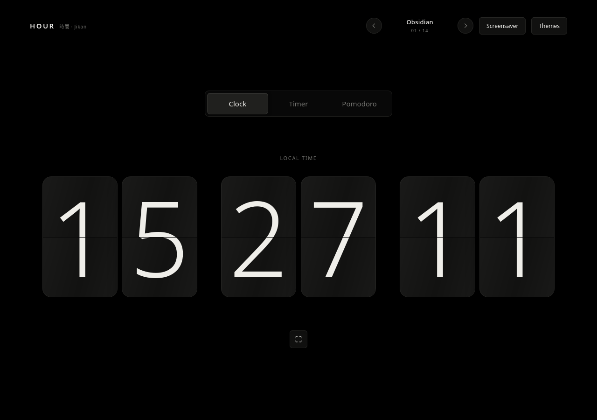

# HOUR — 時間 (Jikan)

HOUR is a quiet, offline-first flip clock and focus timer for Linux. The same dependency-free website also runs directly in a modern browser.



HOUR is a personal project, shared as-is under the GNU GPL version 3. Contributions and forks are welcome.

## Features

- Mechanical flip clock showing local time
- Configurable countdown timer and Pomodoro work/break cycles
- Fourteen built-in palettes and a directional theme carousel
- Custom themes: create, edit, rename, duplicate, save, select, and delete
- 12- or 24-hour local clock; in 12-hour mode, hover over the clock to reveal AM/PM
- Optional bouncing screensaver that preserves the selected display mode, with a configurable inactivity delay
- Browser fullscreen, keyboard controls, reduced-motion support, and locally saved preferences
- No accounts, network calls, frontend frameworks, or remote assets

## Run the website

Open `index.html` in a modern browser. It remains the canonical frontend and works without a web server or build step. Custom themes, selected theme, clock format, timer settings, and screensaver preferences are stored in that browser's local storage.

## Use HOUR

Choose **Clock**, **Timer**, or **Pomodoro** from the mode selector. Timer and Pomodoro modes provide editable durations and Start/Pause and Reset controls; Pomodoro advances automatically through work and break sessions. The theme arrows cycle through built-in and saved custom themes. Open **Themes** to create, edit, rename, duplicate, save, or delete custom palettes and configure the clock format and screensaver delay.

In 12-hour mode, hover over the clock to reveal AM/PM beside the seconds. Use the fullscreen button or **F** to enter fullscreen; **Escape** exits. Start the bouncing screensaver with its button or enable an inactivity delay in **Themes**. Escape or any normal interaction exits the screensaver; it shows only the current clock or countdown digits.

## Run the Linux desktop app

The Electron desktop app wraps the same local HTML, CSS, and JavaScript as the browser version. It bundles Chromium and needs no web server or internet connection at runtime.

### Install the AppImage

Download `HOUR-1.0.0-x86_64.AppImage` from the project's GitHub Release, make it executable if needed, and run it:

```sh
chmod +x HOUR-1.0.0-x86_64.AppImage
./HOUR-1.0.0-x86_64.AppImage
```

AppImage launch may require FUSE 2 compatibility on some distributions. AppImage compatibility also depends on the host's glibc and graphics drivers; the release has only been verified on the system where it was built and manually tested.

### Run from source or build

Install Node.js 22.12 or newer and npm. Installing dependencies and making a build require an internet connection to download the locked npm packages and Electron runtime. From the project directory:

```sh
npm ci
npm run app:dev
```

Build a Linux AppImage with:

```sh
npm run app:build
```

The AppImage is written to `release/`. The desktop app leaves Chromium's normal GPU selection enabled and requests GPU rasterization when supported. Actual animation smoothness and refresh rate depend on the operating system, driver, and display.

The generated `release/` directory, AppImages, `node_modules/`, and `dist/` are excluded from Git. Upload the AppImage separately as a GitHub Release asset; the GitHub source archive should contain the source and lockfile, not the prebuilt binary.

## Project layout

- `index.html` — canonical standalone website and frontend
- `main.cjs` — minimal Electron main process
- `assets/` — application icons
- `LICENSE` and `COPYRIGHT` — GNU GPL version 3 and project copyright notice

There are no third-party frontend libraries or remote assets. The desktop shell uses Electron and Chromium under their respective upstream licenses. The included HOUR icon is original project artwork.

## Source code

The source code and build instructions are maintained in the [rob0ticbro/HOUR repository](https://github.com/rob0ticbro/HOUR). Clone it and follow the instructions above to run or build HOUR.

## License

HOUR is distributed under the GNU General Public License, version 3. See [LICENSE](LICENSE) and [COPYRIGHT](COPYRIGHT).
