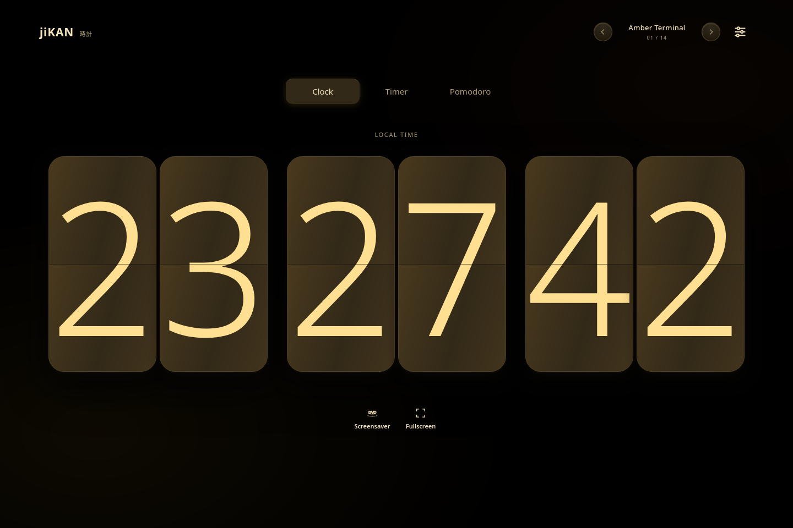

# jiKAN — 時計

A polished, offline flip clock and focus timer for your desktop. Pick Clock, Timer, or Pomodoro, make it yours, then get out of the way.



## The good stuff

- **A proper flip clock** with smooth mechanical-style digit transitions
- **Clock, Timer, and Pomodoro** modes, including automatic work and break cycles
- **Digits-only fullscreen** for a clean clock in a black room; press **F** to enter and **Escape** to exit
- **Fourteen built-in themes** plus an editor for your own color palettes
- **12/24-hour time**, adjustable clock size, and configurable timer durations
- **A bouncing screensaver** with an optional inactivity timer
- **Thoughtful controls** with custom dropdowns and sliders, keyboard shortcuts, and reduced-motion support
- **Works offline** as a local HTML page or Linux desktop app—no accounts, network calls, frameworks, or remote assets

## A quick note: vibe-coded

jiKAN is vibe-coded: I brought the idea, opinions, prompts, and testing, and AI helped write a lot of the code. It's my first open-source project, so if you spot a rough edge, bug reports and PRs are very welcome. It's released under GPL-3.0.

## Run it in your browser

Open `index.html` in a modern browser. No server, setup, or internet connection needed. Your theme, clock format, timer settings, and screensaver preferences stay in that browser's local storage.

## Use jiKAN

Choose **Clock**, **Timer**, or **Pomodoro** from the mode selector. Timer and Pomodoro modes provide editable durations and Start/Pause and Reset controls; Pomodoro advances automatically through work and break sessions. Use the theme arrows to browse built-in and saved custom themes. Open **Themes** to create, edit, duplicate, save, or delete palettes.

In 12-hour mode, hover over the clock to reveal AM/PM beside the seconds. Use the fullscreen button or **F** to enter fullscreen; **Escape** exits. Start the screensaver with its button or enable an inactivity delay in **Settings**.

## Linux desktop app

The Electron app wraps the same local HTML, CSS, and JavaScript. Chromium is bundled, so there's no web server or internet connection needed to run it.

### Download the AppImage

Grab `jiKAN-1.1.0-x86_64.AppImage` from [GitHub Releases](https://github.com/rob0ticbro/jiKAN/releases), make it executable if needed, and run it:

```sh
chmod +x jiKAN-1.1.0-x86_64.AppImage
./jiKAN-1.1.0-x86_64.AppImage
```

AppImage launch may need FUSE 2 compatibility on some distributions. Compatibility also depends on the host's glibc and graphics drivers.

### Run from source or build

Install Node.js 22.12 or newer and npm. Installing dependencies and building need an internet connection to download the locked npm packages and Electron runtime. From the project directory:

```sh
npm ci
npm run app:dev
```

Build a 64-bit x86 Linux AppImage with:

```sh
npm run app:build
```

The AppImage is written to `release/`. The desktop app uses Chromium's normal hardware-acceleration selection; actual animation performance depends on your operating system, driver, and display.

## Project layout

- `index.html` — standalone website and frontend
- `main.cjs` — minimal Electron main process
- `assets/` — jiKAN application icon
- `LICENSE` and `COPYRIGHT` — license and project copyright notice

There are no third-party frontend libraries or remote assets. The desktop shell uses Electron and Chromium under their respective upstream licenses.

## License

jiKAN is distributed under the GNU General Public License, version 3. See [LICENSE](LICENSE) and [COPYRIGHT](COPYRIGHT).
